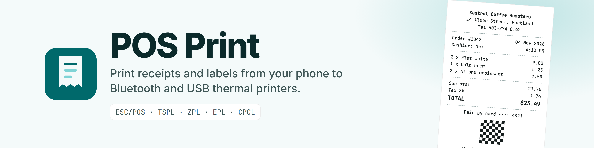
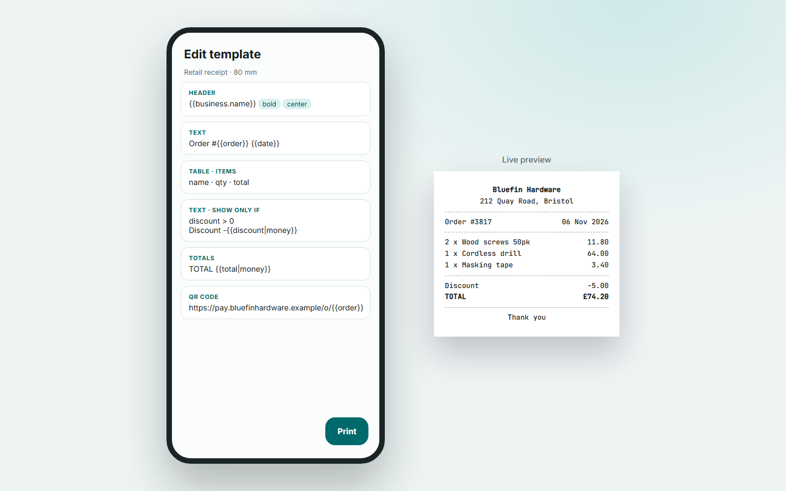
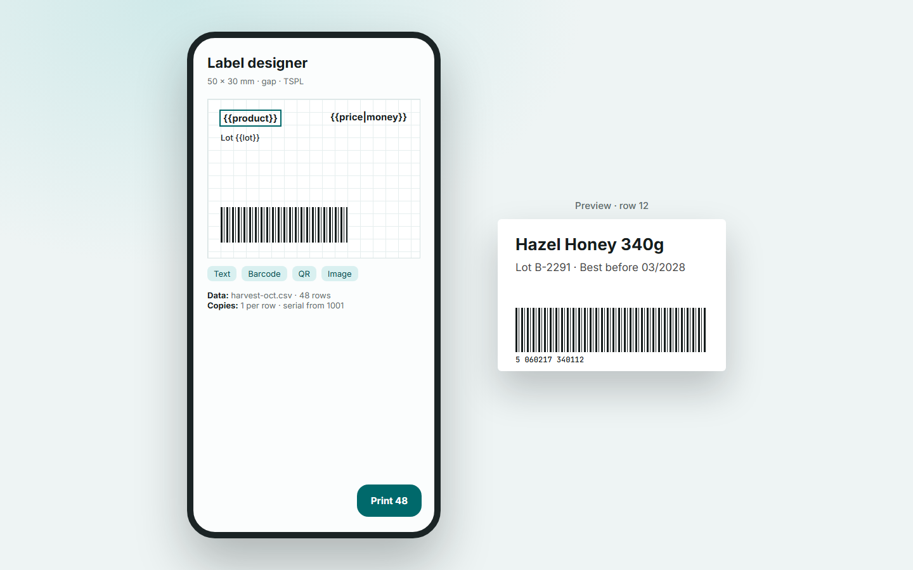

<picture>
  <source media="(prefers-color-scheme: dark)" srcset="assets/banner-dark.png">
  
</picture>

# POS Print

Android app (Kotlin, Jetpack Compose, Material 3, Hilt, Room, DataStore) for thermal receipt and label printers
over **Bluetooth** and **USB**, plus normal A4/A5/Letter paper. Offline-first, no account. Min SDK 26, phones and tablets.

## Status

All five phases are implemented and build. **41 unit tests pass.** The app has **not yet been run on a real printer or device**:
the instrumented UI tests compile but were not executed (no emulator was available), and the label languages
(TSPL/ZPL/EPL/CPCL) are unit-tested for command output only. Test with your printer and read "Known limitations".

| Area | What is there |
|---|---|
| Connectivity | Bluetooth Classic (scan, pair, SPP) and USB host. Android 12+ runtime permissions, auto-reconnect, status chip, plain-language errors (paper out, cover open, offline, permission denied), test print, self-test. Wi-Fi/LAN is not included (add a `PrinterTransport`). |
| Queue | Background print queue with retry, cancel and persisted history with reprint. |
| Receipts | Text styles, columns/tables, images (threshold / Floyd-Steinberg / ordered dithering), QR, Code128/39/EAN13/UPC-A/ITF, PDF417, cash drawer, cut, beep, code pages, bitmap fallback for Arabic/Urdu/Hindi/CJK/italics, margins, density, line spacing, characters per line. |
| Templates | 10 starters preloaded, block editor with live paper preview, variables `{{x}}`, filters, conditionals, JSON import/export. |
| Labels | Visual designer (drag, resize, rotate, snap grid), size presets/custom, gap / black-mark / continuous, `{{variables}}`, CSV and .xlsx batch import, copies, quantity column, auto-increment `{{serial}}`, TSPL, ZPL, EPL, CPCL, camera scan-to-print. |
| Paper | Template to A4/A5/Letter with preview, margins, scale, orientation, Android Print Framework (Wi-Fi/USB office printers), PDF export. |
| Utilities | Quick Print, Share-sheet printing (text/image/PDF), image and PDF page printing, Mini POS, backup/restore, hex console and command log. |
| Settings | Business profile and logo, currency/date/time/number formats, theme (light/dark/system, dynamic colour), forced LTR/RTL, paper defaults. |

## Screenshots





## Documentation

Setup guides, usage and troubleshooting are in the [wiki](https://github.com/anand34577/pos-print/wiki); its source is in `docs/wiki/`.

## Build

Needs **JDK 17** (Gradle 8.14 cannot run on JDK 25) and Android SDK 35.

```bash
./gradlew :app:testDebugUnitTest :app:assembleDebug
```

APK: `app/build/outputs/apk/debug/`. In Android Studio set *Gradle JDK* to 17. Create `local.properties` with `sdk.dir=...` if missing.

Release: copy `keystore.properties.example` to `keystore.properties` (not committed), fill it in, then `./gradlew :app:assembleRelease`.
R8 and resource shrinking are on; keep rules are in `app/proguard-rules.pro`. Without `keystore.properties` the release APK is unsigned.

UI tests (need a device or emulator): `./gradlew :app:connectedDebugAndroidTest`.

## Architecture

```
UI (Compose) -> ViewModel -> data services -> drivers / transports / Room / DataStore
```

```
domain/
  model/       Printer, PrintError, PrintJob (pure Kotlin)
  template/    Template, blocks, label elements, JSON
  render/      TemplateEngine (variables, conditionals, tables, wrapping), LabelPlanner,
               barcodes (zxing, pure JVM), dithering, image/raster types
  io/          CSV and .xlsx parsing
  printer/     PrinterDriver, PrinterTransport interfaces
data/
  printer/escpos/   EscPosBuilder, EscPosDriver, ReceiptCompiler
  printer/label/    TsplDriver, ZplDriver, EplDriver, CpclDriver
  printer/          DriverRegistry, PrinterConnectionManager, PrintService (queue), CommandLog
  transport/        BluetoothTransport, UsbTransport
  discovery/        Bluetooth scan/pair, USB attach/detach
  render/           Android bitmap text, images, label raster (shared by preview and print)
  print/            TemplatePrinter (template + data + printer -> queue), DocumentLayout/DocumentPrinter (paper)
  db/               Room: printers, templates, history
  settings/, SettingsStore, BackupManager, StarterTemplates, IncomingShare
ui/           home, printers, addprinter, templates, labels, paper, pos, quick, file, scan, history, settings
```

Preview and print share code: the editors show the exact resolved blocks (`TemplateEngine.resolve`) that the compilers send to the printer,
and the label preview is drawn by the same `LabelRaster` that rasterises label text for printing.

## Template syntax

* Variables: `{{name}}`, with filters `{{price|money}}`, `{{x|number}}`, `{{x|upper}}`, `{{x|lower}}`.
* Built-ins: `{{date}}`, `{{time}}`, `{{datetime}}`, `{{business.name}}`, `{{business.address}}`, `{{business.phone}}`, `{{business.taxId}}`, `{{business.footer}}`; labels also get `{{serial}}`.
* Conditionals (the "Show only if" field on any block): `discount > 0`, `customer`, `!paid`, `status == "paid" && total >= 100`.
* Tables take rows from a list variable (`items`); each row has the fields you name (`name`, `qty`, `price`, `total`).
* Templates export as `.posprint.json` and import from the Templates tab.

## Supported printers

Any ESC/POS-compatible 58 mm or 80 mm thermal printer over Bluetooth SPP or USB should work (Epson TM series, Xprinter, Rongta, Gprinter,
Zjiang, Munbyn, Sunmi and generic clones); label printers that speak TSPL (TSC, Xprinter/Gprinter label models), ZPL (Zebra), EPL or CPCL.
Set the printer type in the setup step or Printers -> Edit profile. A receipt printer can also print label templates as one image.
BLE-only printers are not supported (classic Bluetooth only).

## Add a printer driver

1. Add a value to `PrinterLanguage`.
2. Implement `PrinterDriver` (for a label language extend `LabelDriver` and implement `emit`, which receives language-neutral primitives from `LabelPlanner`).
3. Register it in `DriverRegistry`.
4. Add unit tests that assert the emitted bytes (see `LabelTest`).

New connection type (e.g. Wi-Fi 9100): implement `PrinterTransport`, add it to `ConnectionType` and `TransportFactory`.

## Troubleshooting

* **No Bluetooth devices on Android 11 or older:** grant Location and turn Location on; Android requires it for scanning.
* **Bluetooth connect fails:** another phone may hold the printer; power-cycle it. Pair in system settings first if in-app pairing fails (PIN usually 0000 or 1234).
* **USB: nothing listed:** use a data-capable OTG cable and tap Allow on the prompt; replug if you dismissed it.
* **Ruler wraps or is cut off on the test page:** switch paper width (58/80 mm) or set characters per line in the profile.
* **Garbled symbols:** pick the matching code page in the profile. Text outside it prints as an image automatically.
* **Faint or dark print:** enable "Set print density" in the profile; clones may ignore it.
* **Label misaligned or skipping:** match media (gap / black mark / continuous) and gap height to your roll; run the printer's own calibration.
* **Label image looks inverted:** bitmap polarity follows each language's spec (TSPL/EPL 0 = black, ZPL/CPCL 1 = black); report your model.
* **No paper/cover errors shown:** many clones never answer status queries, so the app assumes OK.
* Use Settings -> Developer tools to send raw hex and inspect the command log.

## Known limitations

* Not verified on physical hardware yet; expect to tune the profile (code page, density, margins) for your model.
* Block order in the receipt editor is changed with up/down arrows; free drag-and-drop is in the label designer.
* The Google Drive option is the system file picker (choose Drive there); there is no direct Drive API or sign-in, to keep the app account-free.
* UI text is English. RTL layout can be forced in Settings, but strings are not yet translated or moved to resources.
* The database upgrade from the Phase 1 dev build (v1) recreates the printer list; later versions need real migrations.
* Label text is always printed as bitmap (so any language and exact sizing work); native printer fonts are not used.
* Rotated barcodes and PDF417 on labels are printed as images.
