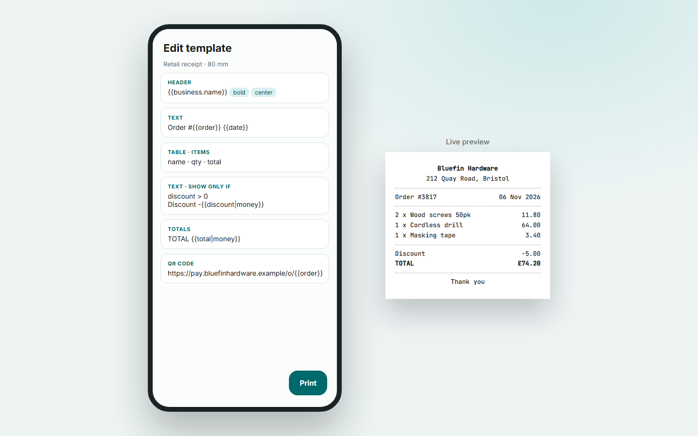

# POS Print

POS Print is an Android app that prints receipts and labels to Bluetooth and USB thermal printers, and to ordinary A4, A5 and Letter printers. It works offline and needs no account.

It's for small shops, stalls and warehouses that want to print from a phone or tablet without a dedicated POS system.

## Start here

1. [Installation](Installation): build the app and put it on a device
2. [Getting Started](Getting-Started): connect a printer and print your first receipt
3. [Usage](Usage): templates, labels, Quick Print, batch import
4. [Template Syntax](Template-Syntax): variables, filters and conditions
5. [Troubleshooting](Troubleshooting): fixes for the common problems

The app has not yet been tested on a physical printer. Expect to tune the printer profile (code page, density, margins) for your model.
