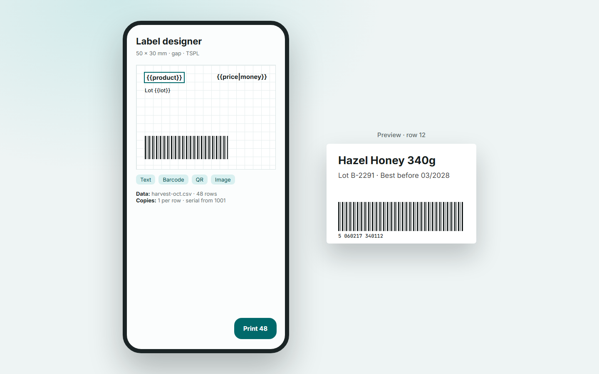

# Usage

## Print something quickly

**Quick Print** takes plain text and prints it on your default printer. You can also share text, an image or a PDF to the app from any other app and it prints it.

## Edit a receipt template

1. Open **Templates** and pick a starter, or create a new one.
2. Add blocks: text, table, image, QR code, barcode, cash drawer, cut, beep.
3. Move blocks with the up and down arrows.
4. Use `{{variables}}` for anything that changes. See [Template Syntax](Template-Syntax).
5. Check the live preview. It shows the same blocks the printer receives.

Export a template as a `.posprint.json` file from its menu, and import it on another device from the Templates tab.

## Design and print labels

1. Open **Labels** and choose a size preset or enter a custom size.
2. Pick the media type that matches your roll: gap, black mark or continuous.
3. Drag, resize and rotate elements. Turn on the snap grid for tidy alignment.
4. To print many labels, import a CSV or `.xlsx` file. Each row becomes a label, and a quantity column sets the copies.
5. Use `{{serial}}` for an auto-incrementing number.

You can also scan a barcode with the camera and print a label from it.

## Print on A4, A5 or Letter

Choose a template, pick the paper size, set margins and scale, and check the preview. Printing goes through the Android Print Framework, so Wi-Fi and USB office printers work. You can export a PDF instead.

## Other tools

* **Mini POS** for simple sales entry.
* **History** keeps past jobs so you can reprint them.
* **Backup and restore** in Settings.
* **Developer tools** in Settings: send raw hex and read the command log.
